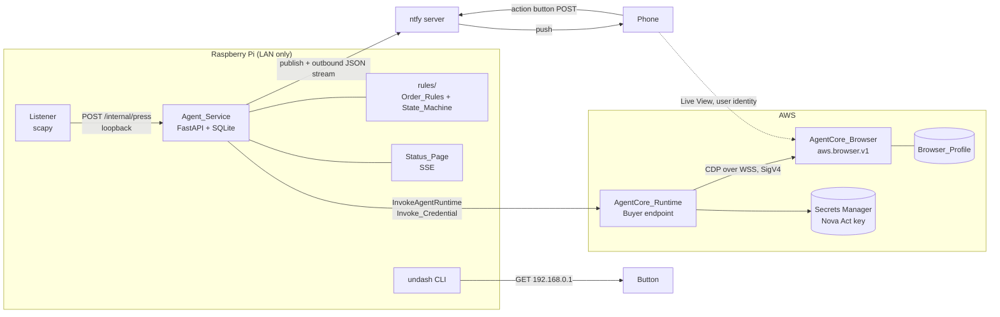
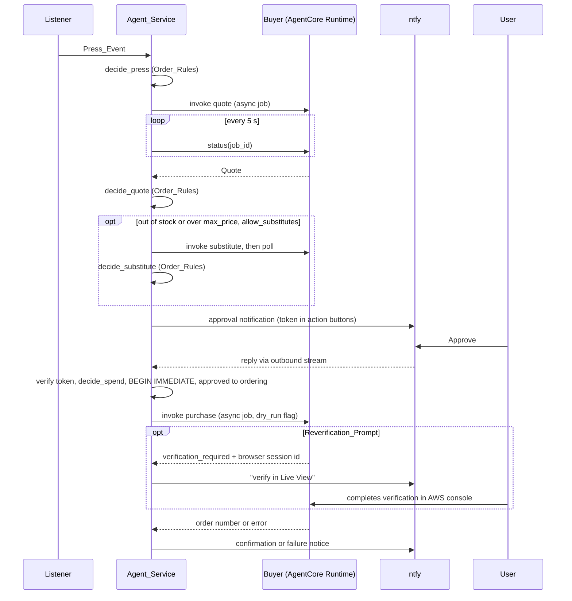

# Design Document

## Overview

GhostShopper has three runtime parts:

1. **Raspberry Pi**: the Listener (scapy, root or `CAP_NET_RAW`) and the Agent_Service (FastAPI, SQLite, ntfy subscriber, Status_Page). Both are plain Python 3.10+ and need no Nova Act, Playwright, or Chrome.
2. **AWS**: one AgentCore_Runtime that hosts the Buyer (Nova Act workflow), one AgentCore_Browser Browser_Profile that holds the Amazon login, and the IAM identities around them. The Buyer drives the system browser `aws.browser.v1` over CDP.
3. **ntfy**: the approval channel. The Pi only makes outbound connections to it.

The design keeps three rules from the product steering:

- Order_Rules and State_Machine are pure Python. The Buyer only reads pages and clicks.
- Every purchase passes through a human approval. There is no auto-approve path.
- Amazon credentials never reach GhostShopper code. The login lives in the Browser_Profile.

Python is the language for all components and for the examples in this document. Examples are interface and data shapes only, not application code.

### Design decisions at a glance

| Question (from requirements gaps) | Decision |
|---|---|
| User agent on the AgentCore_Browser session | CDP `Emulation.setUserAgentOverride`, applied by the Buyer to every page target before first navigation, with a fail-closed check of `navigator.userAgent` and of request headers. `StartBrowserSession` has no user agent field. |
| Starting a session from the profile | `bedrock_agentcore.tools.browser_client.browser_session(region, profile_configuration={"profileIdentifier": ...})`. The current SDK `start()` and `browser_session()` accept `profile_configuration`. |
| Invocation time limit | Asynchronous job pattern. `InvokeAgentRuntime` returns an accepted job in under a second. The Agent_Service polls with the same `runtimeSessionId`. The synchronous request limit is 15 minutes, and the 10-minute verification wait plus page work can exceed it. |
| Live View link | Never sent in a notification. The notification names the AWS region and browser session ID and points to the AgentCore console. The user opens Live View under their own identity. |
| IAM action and ARNs | `bedrock-agentcore:InvokeAgentRuntime` on exactly two resources: the runtime ARN and the runtime-endpoint ARN. |
| IaC tool | AWS CDK in Python, using the L1 `Cfn*` constructs from `aws-cdk-lib`. |
| Nova Act authentication | API key, as required. The key sits in Secrets Manager and the Buyer entry point exports it to the `NOVA_ACT_API_KEY` environment variable at start. |
| Status page transport | Server-Sent Events. |

### Sources and verification status

Checked while writing this design (content rephrased from the linked pages):

- [AgentCore quotas](https://docs.aws.amazon.com/bedrock-agentcore/latest/devguide/bedrock-agentcore-limits.html): synchronous request timeout 15 minutes (not adjustable), asynchronous job maximum 8 hours, idle session timeout 15 minutes (adjustable), `InvokeAgentRuntime` payload up to 100 MB.
- [Asynchronous and long running agents](https://docs.aws.amazon.com/bedrock-agentcore/latest/devguide/runtime-long-run.html): a session that reports `HealthyBusy` on `/ping` stays alive past the idle timeout. The entry point must not block the ping.
- [IAM actions and resource types for AgentCore](https://docs.aws.amazon.com/service-authorization/latest/reference/list_amazonbedrockagentcore.html): `InvokeAgentRuntime` requires both the `runtime` and `runtime-endpoint` resource types. ARN formats are in the IAM section below.
- [Browser profiles](https://docs.aws.amazon.com/bedrock-agentcore/latest/devguide/browser-profiles.html) and [StartBrowserSession](https://docs.aws.amazon.com/bedrock-agentcore/latest/APIReference/API_StartBrowserSession.html): the request has `profileConfiguration`, `proxyConfiguration`, `extensions`, `enterprisePolicies`, `viewPort`, and `sessionTimeoutSeconds`. It has no user agent field.
- [bedrock-agentcore SDK browser client](https://github.com/aws/bedrock-agentcore-sdk-python/blob/main/src/bedrock_agentcore/tools/browser_client.py): `browser_session()` accepts `profile_configuration`. `generate_ws_headers()` returns the CDP URL and SigV4 headers. `generate_live_view_url()` caps expiry at 300 seconds.
- [CloudFormation `AWS::BedrockAgentCore::Runtime`](https://docs.aws.amazon.com/AWSCloudFormation/latest/TemplateReference/aws-resource-bedrockagentcore-runtime.html), [`RuntimeEndpoint`](https://docs.aws.amazon.com/AWSCloudFormation/latest/TemplateReference/aws-resource-bedrockagentcore-runtimeendpoint.html), and [`BrowserProfile`](https://docs.aws.amazon.com/AWSCloudFormation/latest/TemplateReference/aws-resource-bedrockagentcore-browserprofile.html): all three exist. The runtime artifact is either `CodeConfiguration` (direct code) or `ContainerConfiguration`.
- [Nova Act README](https://github.com/aws/nova-act/blob/main/README.md): `user_agent` and `proxy` only apply when Nova Act launches the browser, not when it attaches over CDP.

Items that no source confirms are marked **Verify** and collected in the "Implementation spikes" section. The first spike runs before the Buyer is built, because the user agent mechanism is a compliance requirement.

## Architecture



### Press-to-purchase flow



## Components and Interfaces

### Package layout

This refines `structure.md`. The Pi image installs the `pi` extra. The AgentCore zip is built from the `buyer` extra.

```
src/ghostshopper/
├── common/       # USER_AGENT, clock protocol, money helpers, MAC normalization
├── listener/     # scapy sniffer, signature classifier, debounce, event POST queue
├── agent/        # FastAPI app, SQLite store, orchestrator, ntfy subscriber, status page
├── rules/        # decide_* functions, state machine (imports only common/)
├── notifier/     # ntfy publisher, message and action-button rendering, reply parsing
├── buyer/
│   ├── schemas.py    # Pydantic models shared by both sides (no nova_act import)
│   ├── client.py     # WorkflowClient protocol + AgentCoreWorkflowClient (boto3)
│   └── runtime/      # cloud side only: entry point, flows, guards, UA gate
├── config/       # YAML models and loader
└── cli/          # undash setup, undash discover
infra/            # CDK app (Python), operator tools
image/            # CustomPiOS module
```

Import boundaries:

- `rules/` imports `common/` only.
- `buyer/runtime/` is the only package that imports `nova_act`, `playwright`, or `bedrock_agentcore`. The Pi image never installs them.
- `agent/` imports `buyer.client` and `buyer.schemas`, never `buyer.runtime`.
- `listener/` is the only package that imports scapy.
- `infra/` is the only place with AWS resource definitions.

### Listener

- **Capture filter:** `arp or (udp and (port 67 or 68))`.
- **Signature classifier** `classify(packet) -> Candidate | None`: an ARP request whose sender IP is `0.0.0.0` (ARP probe), or a DHCP message of type Request. The candidate carries the source MAC and the packet time. The Listener applies no vendor OUI filter. The Agent_Service decides by Config_File membership, which also feeds `undash discover`.
- **Debounce** `Debouncer(default_window, per_mac_windows)`: keeps `last_accepted[mac]`. A press is accepted when `now - last_accepted[mac] >= window`. The clock is the packet timestamp, so a pcap replay is deterministic. In live mode the packet timestamp is the capture time.
- **Delivery:** accepted events go into an in-memory queue. A worker thread POSTs each to `http://127.0.0.1:<port>/internal/press` with `httpx`, retrying up to 3 times at 5-second intervals and logging each failure. A dropped event is logged. The sniff loop never blocks on delivery. In pcap mode the process drains the queue, then exits 0.
- **Debounce windows:** the Listener reads `debounce_seconds` per Button from the Config_File. Buttons not in the file use 30 seconds.

### Agent_Service

Modules inside `agent/`:

| Module | Responsibility |
|---|---|
| `app.py` | FastAPI routes: `POST /internal/press` (loopback source only), `GET /` (Status_Page), `GET /events` (SSE), `GET /api/state` (JSON snapshot). |
| `store.py` | SQLite access. All transitions go through `Store.transition`, which calls the State_Machine, then writes the row and the history entry in one transaction. |
| `orchestrator.py` | One asyncio task per Order. Calls Order_Rules, `WorkflowClient`, `Notifier`, and `Store`. |
| `ntfy_stream.py` | Outbound JSON stream subscriber with backoff and resume. |
| `approvals.py` | Token creation, hashing, verification, expiry sweep. |
| `startup.py` | Config load, environment checks, restart recovery. |

**Network exposure.** The service listens on the LAN address so the Status_Page is reachable from the home network. `/internal/press` rejects any request whose client address is not loopback. There is no tunnel and no public callback URL (Req 8.2). The Status_Page has no login. It shows no token and no secret (Req 16.6). The README tells the user to keep it on the trusted LAN.

**Clock.** Every time-dependent component takes a `Clock` protocol (`now() -> datetime` in UTC, `sleep(seconds)`). Tests inject a controllable clock.

**Day boundary.** Daily_Spend_Cap day boundaries use the host local time zone. The day of a placed order is `placed_at.astimezone().date()`, which follows DST. The day start and end are computed in local time and converted to UTC for the SQL range query.

**Restart recovery** (`startup.py`, runs before the ntfy stream and orchestrator start):

| Stored state | Action |
|---|---|
| `ordering` | Transition to `failed`, reason `interrupted`, notify "check the Amazon account" (Req 10.5). |
| `awaiting_approval` | Keep. The token row keeps its original `expires_at`. The expiry sweeper resumes (Req 10.6). |
| `pressed`, `quoted`, `approved` | Transition to `failed`, reason `interrupted`. See "Design additions" below. |
| terminal states | Untouched. |

### Order_Rules (`rules/decisions.py`)

All functions are pure. Money is `Decimal` in the rules and integer cents in SQLite.

```python
class PressDecision: Accept | Ignore(reason: Literal["in_flight", "cooldown", "unconfigured"])

def decide_press(button: ButtonConfig | None, in_flight: bool,
                 last_real_placed_at: datetime | None, now: datetime) -> PressDecision: ...

class QuoteDecision: RequestApproval | NeedSubstitute | Fail(reason: Literal["out_of_stock", "over_max_price"])

def decide_quote(quote: Quote, button: ButtonConfig) -> QuoteDecision: ...

class SubstituteDecision: RequestApproval | Fail(reason: Literal["over_max_price", "no_substitute"])

def decide_substitute(sub: Substitute | None, button: ButtonConfig) -> SubstituteDecision: ...

class SpendDecision: Allow | Fail(reason: Literal["spend_cap"])

def decide_spend(placed_total_today: Decimal, order_total: Decimal, cap: Decimal) -> SpendDecision: ...
```

Rule table:

| Function | Input condition | Outcome |
|---|---|---|
| `decide_press` | `button is None` | Ignore `unconfigured` |
| | in flight | Ignore `in_flight` |
| | `now < last_real_placed_at + cooldown_days` | Ignore `cooldown` |
| | otherwise | Accept |
| `decide_quote` | out of stock and `allow_substitutes` | NeedSubstitute |
| | out of stock | Fail `out_of_stock` |
| | price over `max_price` and `allow_substitutes` | NeedSubstitute |
| | price over `max_price` | Fail `over_max_price` |
| | otherwise | RequestApproval |
| `decide_substitute` | `sub is None` or `sub` out of stock | Fail `no_substitute` |
| | `sub.price > max_price` | Fail `over_max_price` |
| | otherwise | RequestApproval (always flagged as substitute) |
| `decide_spend` | `placed_total_today + order_total > cap` | Fail `spend_cap` |
| | otherwise | Allow |

`decide_press` checks `unconfigured` first, then `in_flight`, then cooldown. The caller computes `last_real_placed_at` from Orders with `state = placed` and `dry_run = 0`, so Dry_Run Orders never feed Cooldown.

**Price basis.** `Quote.price` and `max_price` are unit prices. `order_total = unit price × quantity` and feeds `decide_spend` and the Daily_Spend_Cap sum. This is an assumption, recorded in the Assumptions section.

### State_Machine (`rules/state_machine.py`)

```python
ALLOWED: frozenset[tuple[State, State]]   # exactly the 11 pairs in Req 10.1
TERMINAL = {placed, denied, expired, failed}

def apply(current: State, target: State) -> State:   # raises IllegalTransition
```

`Store.transition` catches `IllegalTransition`, logs the rejected pair with the order ID, leaves the row unchanged, and returns `False`.

### WorkflowClient (`buyer/client.py`)

The Agent_Service depends on this protocol only.

```python
class WorkflowClient(Protocol):
    def start(self, request: BuyerRequest) -> JobRef: ...      # returns quickly
    def poll(self, ref: JobRef) -> JobStatus: ...              # returns quickly
```

`AgentCoreWorkflowClient` implements it with `boto3.client("bedrock-agentcore")` and `invoke_agent_runtime(agentRuntimeArn=..., qualifier=<endpoint name>, runtimeSessionId=..., payload=...)`. Details:

- **User agent:** the botocore `Config(user_agent_extra="ghostshopper/0.1 Agent/ghostshopper")` carries the Agent_User_Agent (Req 15.1).
- **Credentials:** the default boto3 chain reads `AWS_ACCESS_KEY_ID`, `AWS_SECRET_ACCESS_KEY`, and `AWS_REGION` from the environment (Invoke_Credential).
- **Session ID:** `runtimeSessionId = f"gs-{order_id_hex}-{action}"`. The order ID is a 32-character hex UUID, so the ID meets the 33-character minimum. One session per order and action means a repeated `start` for the same order and action lands on the same microVM, which returns the existing job instead of starting a second one.
- **Blocking calls:** boto3 is synchronous. The orchestrator calls the client through `asyncio.to_thread`.
- **Errors:** any boto3 or network exception is raised as `BuyerUnavailable`. The orchestrator maps it to `failed` with reason `buyer_unavailable`.

Purchase retry rule: `start(purchase)` is retried only on a throttling error, where the service rejected the request before running it. Any other error fails the Order. A retry after an ambiguous failure could start a second purchase if the first microVM had died mid-click.

### Buyer wire protocol (`buyer/schemas.py`)

Requests and responses are JSON, validated by Pydantic on both sides.

```python
class BuyerRequest(BaseModel):
    action: Literal["quote", "substitute", "purchase", "status"]
    order_id: str
    job_id: str | None            # status only
    asin: str | None              # quote, purchase (substitute ASIN when is_substitute)
    quantity: int | None          # purchase
    approved_unit_price: Decimal | None   # purchase, see Design additions
    dry_run: bool | None          # purchase, copied from Config_File (Req 11.6)
    user_agent: str               # expected token source, from common.USER_AGENT

class JobStatus(BaseModel):
    job_id: str
    state: Literal["running", "verification_required", "succeeded", "failed"]
    browser_session_id: str | None        # always set once the browser session exists
    verification_deadline: datetime | None
    result: Quote | Substitute | PurchaseResult | None
    error_code: Literal["invalid_quote", "user_agent_unverified", "verification_timeout",
                        "price_changed", "purchase_error"] | None
    error_detail: str | None              # short, no page content, no secrets
```

Result models:

```python
class Quote(BaseModel):          # also the act_get schema
    title: str
    price: Decimal               # unit price, USD
    availability: Literal["in_stock", "out_of_stock"]
    delivery_estimate: str       # free text, shown to the user

class Substitute(Quote):
    asin: str                    # validated against ^[A-Z0-9]{10}$ and != configured ASIN

class PurchaseResult(BaseModel):
    order_number: str | None     # None for dry run
    reached_place_order: bool    # True when dry run stopped at the final step
```

The Buyer never receives a password, card number, or one-time code, and the schemas have no field for them (Req 13.1).

### Buyer runtime (`buyer/runtime/`)

**Entry point.** `BedrockAgentCoreApp` with a non-blocking `@app.entrypoint`:

- `quote`, `substitute`, `purchase`: validate the request, register a job under `job_id = order_id + action`, start the job in a worker thread, call `app.add_async_task(...)` so `/ping` reports `HealthyBusy`, and return `JobStatus(state="running")` immediately. A repeated start with the same `job_id` returns the existing job.
- `status`: return the job's current `JobStatus`.
- The job table is in memory. It lives as long as the microVM session. The runtime lifecycle sets `idleRuntimeSessionTimeout` to 300 seconds so finished sessions are reclaimed quickly.

**Bootstrap.** At process start, if `NOVA_ACT_API_KEY` is unset, the entry module reads the secret named by `NOVA_ACT_SECRET_ARN` from Secrets Manager and sets the environment variable. The Buyer then reads the key only from the environment (Req 12.7). A log filter redacts the key value.

**Browser session and CDP.** Each job does the following, inside one context manager that always stops the browser session (Req 12.8):

1. `browser_session(region, profile_configuration={"profileIdentifier": PROFILE_ID}, session_timeout_seconds=1800, name=f"gs-{order_id}")` starts a session from the Browser_Profile. If the SDK helper ever rejects the argument, the fallback is `boto3 start_browser_session(profileConfiguration=...)` plus a manual `BrowserClient` for `generate_ws_headers()`.
2. `NovaAct(cdp_endpoint_url=ws_url, cdp_headers=headers, starting_page="about:blank")`. The Nova Act `user_agent` option is not used because it applies only to browsers that Nova Act launches.
3. **User agent gate** (below). Navigation to amazon.com happens only after the gate passes.

**User agent mechanism (Req 15.2 to 15.4).** The Buyer uses CDP, not browser launch options:

1. Open a browser-level CDP session through Playwright (`browser.new_browser_cdp_session()`).
2. Call `Target.setAutoAttach` with `autoAttach=true`, `waitForDebuggerOnStart=true`, `flatten=true`. For every new page target, including popups and new tabs, send `Emulation.setUserAgentOverride` with `userAgent = USER_AGENT` before `Runtime.runIfWaitingForDebugger`. This closes the race where a new tab makes its first request before the override.
3. Apply the same override to the pages that already exist, including the `about:blank` page that Nova Act holds.
4. Read `navigator.userAgent` from the page. `verify_user_agent(observed)` returns true only if the value contains `Agent/ghostshopper`. If false, stop the session and fail with `user_agent_unverified`. No navigation to Amazon has happened.
5. A Playwright `context.on("request")` listener checks the `user-agent` header of every request. A request without the token stops the job with `user_agent_unverified`. This second layer catches targets the override missed.

The override is a CDP session property, so the Buyer keeps the session objects alive until the browser session ends. A profile-based session uses the default browser context, so a new context with a Playwright `user_agent` option would lose the profile cookies. That is why the design uses CDP overrides.

**Flows.** Each flow calls `act` with one small instruction at a time and runs the page guard between steps. Every prompt starts with a fixed preamble: "You are an automated software agent, not a human. If asked whether you are a human, state that you are an automated agent. Never enter a password, card number, or one-time code." The Buyer adds no delays and no input pacing (Req 15.5).

| Flow | Steps |
|---|---|
| `quote` | Navigate to `https://www.amazon.com/dp/<ASIN>`. `act_get` with `Quote.model_json_schema()`. Validate with Pydantic. Invalid or `matches_schema` false means `invalid_quote`. |
| `substitute` | Open the configured product page. `act_get` for at most one alternative product that the page itself offers, with `Substitute` as the schema. Return `None` if the page offers none. The Buyer applies no price or availability judgement. Order_Rules decide. |
| `purchase` | Navigate to `/dp/<asin>` of the request. Set quantity. Click Buy Now. Read the checkout total with `act_get`. If the total per unit exceeds `approved_unit_price`, stop with `price_changed`. If `dry_run`, stop and return `reached_place_order=true`. Otherwise click Place Order and read the order number with `act_get`. |

**Page guard** (`guards.py`, pure and deterministic, no model):

```python
def is_reverification(url: str, dom: DomSignals) -> bool: ...
```

It returns true when the URL path matches Amazon sign-in, multi-factor, or CAPTCHA routes (for example `/ap/signin`, `/ap/mfa`, `/ap/cvf`, `/errors/validateCaptcha`), or when the DOM has a password input, a one-time-code input, a CAPTCHA image, or a card number input. This covers Req 13.3 and 14.1. The guard runs before and after each `act`, because an `act` can navigate to a sign-in page.

**Verification wait** (Req 14): on a positive guard result the job sets `state="verification_required"`, publishes `browser_session_id` and `verification_deadline = now + 10 min`, and polls the guard every 5 seconds with the Playwright connection. The user takes over in the console and releases control. When the guard clears, the job resumes at the interrupted step and saves the profile (see below). At the deadline the job fails with `verification_timeout`. The Buyer never solves or bypasses a CAPTCHA (Req 14.6). A question about being a human appears to the Buyer as a guard hit, so it stops and waits for a person.

**Profile save.** The Buyer calls `SaveBrowserSessionProfile` only after a Reverification_Prompt cleared in this session. A save overwrites the profile, so the Buyer never saves a session that did not pass a signed-in check. Normal runs do not save.

**Verify:** while the user holds control in Live View, the console disables the automation stream. The Buyer's CDP connection may drop and reconnect when control is released. The waiter must tolerate connection errors during the wait and re-attach. See spike 4.

### Orchestrator polling rules

| Setting | Value |
|---|---|
| Poll interval | 5 seconds |
| Tolerated consecutive poll errors | 6 (30 seconds), then fail with `buyer_unavailable` |
| Quote and substitute job limit | 300 seconds |
| Purchase job limit | 900 seconds, extended by up to 600 seconds after `verification_required` |

On `verification_required` the orchestrator publishes one notification and keeps polling. The Order stays in its current state (`pressed` or `ordering`) with `buyer_status = verification_required` on the row. This is not an Order_State, so the State_Machine is unchanged.

A purchase that fails with `buyer_unavailable` after reaching `ordering` carries the same "check the Amazon account" text as `interrupted`, because the outcome is unknown.

Result mapping:

| Buyer outcome | Order outcome |
|---|---|
| `Quote` valid | `quoted`, then `decide_quote` |
| `invalid_quote` | `failed` / `invalid_quote` |
| `user_agent_unverified` | `failed` / `user_agent_unverified` |
| `verification_timeout` | `failed` / `verification_timeout` |
| `price_changed` | `failed` / `price_changed` |
| `purchase_error` | `failed` / `purchase_error` |
| `PurchaseResult` with order number | `placed`, order number stored |
| `PurchaseResult` with `reached_place_order` and dry run | `placed`, `dry_run=1`, no order number |
| `BuyerUnavailable`, poll limit, or job limit | `failed` / `buyer_unavailable` |

### Notifier and approvals

**Publish.** `POST {ntfy_url}/{notification_topic}` with JSON. Headers: `Authorization: Bearer <ntfy_Access_Token>` and `User-Agent: ghostshopper/0.1 Agent/ghostshopper`.

**Approval message.** Text is `"<title> is $<price>, arriving <delivery>. Approve?"`. For a Substitute the title line begins with `Substitute:` and the message states the Substitute title, price, and delivery date. The message has two ntfy `http` actions:

```json
{"action": "http", "label": "Approve", "url": "<ntfy_url>/<reply_topic>", "method": "POST",
 "headers": {"Authorization": "Bearer <token>"},
 "body": "{\"order_id\":\"…\",\"token\":\"…\",\"decision\":\"approve\"}"}
```

The Deny action is identical with `"decision":"deny"`. The access token appears in the notification payload because ntfy action buttons send their own headers. Anyone who can read the Notification_Topic already holds the token. The README recommends a dedicated ntfy user whose ACL covers only these two topics.

**Token lifecycle.**

1. `secrets.token_urlsafe(32)` creates the token (256 bits).
2. The store keeps `sha256(token)`, `order_id`, `created_at`, `expires_at = created_at + 10 min`, and `used_at`. The raw token is never stored or logged.
3. A reply is accepted when the hash is known, `used_at` is null, `now < expires_at`, `order_id` matches the bound order, and `decision` is `approve` or `deny`. Acceptance sets `used_at` in the same transaction as the Order transition.
4. A rejected reply is ignored and logged with `order_id` and one rejection reason: `unknown`, `used`, `expired`, `order_mismatch`, or `bad_decision`.
5. An expiry sweeper runs every 5 seconds. It moves each `awaiting_approval` Order whose `expires_at` has passed to `expired` and notifies.

**ntfy stream** (`ntfy_stream.py`): `GET {ntfy_url}/{reply_topic}/json?since=<last_id>` through `httpx` streaming, with the access token and user agent headers. The first run uses `since=latest`. After each processed message the last ID is written to the `meta` table. Disconnects log and retry with delay `min(1 * 2^n, 60)` seconds. The retry counter resets after a message arrives.

### Approval to purchase

When a valid approve reply arrives:

1. Transition `awaiting_approval` to `approved`.
2. Open `BEGIN IMMEDIATE`. Read `placed_total_today` (state `placed`, `dry_run = 0`, current local day). Call `decide_spend`. On Allow, transition `approved` to `ordering` and commit. On Fail, transition to `failed` / `spend_cap` and commit. Dry_Run Orders also pass through this check, so the cap is evaluated before every purchase, including Substitutes (Req 9.9). The sum itself excludes Dry_Run Orders (Req 9.2).
3. After commit, start the purchase job.

`BEGIN IMMEDIATE` serializes the check and the transition across threads and processes (Req 9.10). Orders in `approved` or `ordering` stay out of the sum, which keeps the accepted concurrent-approval risk.

### Status_Page

- `GET /` serves one HTML page with a small inline script. It renders recent presses (MAC, time, outcome), Orders (Button name, product, state, price, order number, timestamps, a "dry run" label when flagged), today's spend against the cap, and a dry-run banner when `dry_run` is true.
- `GET /events` is a Server-Sent Events stream. The orchestrator and the press handler call `Hub.publish(event)`, which fans out to connected clients. The browser reloads the affected section on each event, so the update arrives well inside 2 seconds. SSE is one-directional, reconnects by itself, and needs no extra dependency, so it beats WebSocket here.
- Token hashes, raw tokens, and secrets are never selected into the page model.

### CLI (`undash`)

- `undash setup --ssid S` (password from a prompt or `--password-stdin`): builds `GET http://192.168.0.1/?amzn_ssid=<quoted>&amzn_pw=<quoted>` with `urllib.parse.urlencode(quote_via=quote)`, a 10-second timeout, and the user agent header. It prints serial number, MAC, firmware version, and battery level from the response. A timeout exits non-zero with a message that the ConfigureMe access point is unreachable. The password is never written to a file or log, and request logging is off for this call.
- `undash discover [--pcap FILE]`: reads `press_log` rows with `outcome = unconfigured`, or classifies a pcap with the Listener classifier. It groups by MAC and prints the count and latest timestamp, or a "no unconfigured buttons were seen" message.

### Configuration

```yaml
dry_run: true                    # default true
daily_spend_cap: 25.00
ntfy:
  url: https://ntfy.sh
  notification_topic: gs-notify-<random>
  reply_topic: gs-reply-<random>
buyer:
  region: us-west-2
  runtime_arn: arn:aws:bedrock-agentcore:us-west-2:111122223333:runtime/ghostshopper_buyer-abc123
  endpoint_name: ghostshopper_live
buttons:
  "ac:63:be:12:34:56":
    name: Paper towels
    asin: B000000000
    quantity: 1
    max_price: 12.50
    cooldown_days: 14
    allow_substitutes: false
    debounce_seconds: 30          # optional
```

Pydantic v2 models validate every field. Loading uses `yaml.safe_load`. `extra="forbid"` rejects unknown keys, which also rejects keys such as `password` or `api_key`. Errors list every invalid field path. MAC keys are normalized to lowercase colon form, and two keys that normalize to the same MAC are rejected. Secrets come from environment variables: `NTFY_ACCESS_TOKEN` and the standard AWS variables on the Pi, and `NOVA_ACT_API_KEY` in the Buyer runtime. The Agent_Service exits at startup, naming the variable, if `NTFY_ACCESS_TOKEN` is unset.

The `buyer.*` fields are not secrets, so they belong in the Config_File. The Pi never uses the Nova Act key. The README lists `NOVA_ACT_API_KEY` (Req 23.4) with the note that the Buyer receives it through the Secrets Manager bootstrap, and that the Pi does not need it.

## Data Models

SQLite file at `/var/lib/ghostshopper/ghostshopper.db`, opened with `PRAGMA journal_mode=WAL` and `foreign_keys=ON`. Timestamps are UTC ISO-8601 text. Money is integer cents.

```
press_log(id INTEGER PK, mac TEXT, pressed_at TEXT, outcome TEXT,        -- accepted | in_flight | cooldown | unconfigured
          order_id TEXT NULL)
orders(id TEXT PK,                                                       -- uuid4 hex
       mac TEXT, button_name TEXT,
       asin TEXT,                    -- configured product
       purchase_asin TEXT,           -- equals asin, or the Substitute ASIN
       is_substitute INTEGER, quantity INTEGER,
       title TEXT, unit_price_cents INTEGER, availability TEXT, delivery_estimate TEXT,
       state TEXT, reason TEXT NULL, dry_run INTEGER,
       order_number TEXT NULL, buyer_status TEXT NULL, browser_session_id TEXT NULL,
       created_at TEXT, updated_at TEXT, placed_at TEXT NULL)
order_history(id INTEGER PK, order_id TEXT, from_state TEXT, to_state TEXT, at TEXT, reason TEXT NULL)
approvals(token_hash TEXT PK, order_id TEXT, created_at TEXT, expires_at TEXT, used_at TEXT NULL)
meta(key TEXT PK, value TEXT)                                            -- ntfy_last_id
```

- An index on `orders(mac, state)` serves the in-flight and cooldown queries. An index on `orders(state, dry_run, placed_at)` serves the spend sum.
- In-flight means `state IN (pressed, quoted, awaiting_approval, approved, ordering)`.
- `dry_run` on the Order is copied from the Config_File when the Order is created and sent in the purchase request. It does not change after creation.
- The schema has no column for a password, card number, one-time code, or raw token.

### Reason codes

| Place | Codes |
|---|---|
| `press_log.outcome` | `accepted`, `in_flight`, `cooldown`, `unconfigured` |
| `orders.reason` for `failed` | `invalid_quote`, `out_of_stock`, `over_max_price`, `no_substitute`, `spend_cap`, `buyer_unavailable`, `user_agent_unverified`, `verification_timeout`, `interrupted`, `price_changed`, `purchase_error` |
| `orders.reason` for `denied` / `expired` | `user_denied` / `approval_timeout` |

## Infrastructure (CDK)

### Tool choice

**AWS CDK in Python (L1 `Cfn*` constructs from `aws-cdk-lib`).** Alternatives compared:

| | CDK (Python) | Raw CloudFormation |
|---|---|---|
| Runtime artifact upload | `Asset` uploads the Buyer zip to the bootstrap bucket and passes bucket and key | Needs a separate upload step and parameters |
| Language | Python, same as the project | YAML |
| Tooling | Node.js and `cdk` CLI, one-time `cdk bootstrap` | `aws cloudformation deploy` only |
| Resource coverage | `CfnRuntime`, `CfnRuntimeEndpoint`, `CfnBrowserProfile` exist | Same resources |

CDK wins on the artifact upload and on keeping the ARN wiring (runtime to endpoint to IAM policy) in one place. The Node.js requirement is a cost the README states. L2 constructs (`aws-bedrock-agentcore-alpha`) are not used because they are alpha and change shape between releases. The synthesized template is plain CloudFormation, so a user without Node.js can still deploy a pre-synthesized template from a release artifact.

### Resources

| Resource | Construct | Notes |
|---|---|---|
| Buyer code | `Asset` (zip) | Built by a script with `uv pip install --python-platform aarch64-manylinux2014 --target build/` for the `buyer` extra, then zipped. Direct code deployment avoids a Docker and ARM64 image build. **Verify** the zip stays under 250 MB compressed and 750 MB uncompressed. Fallback: `ContainerConfiguration` with an ARM64 image. |
| Nova Act key secret | `secretsmanager.Secret` | Created empty. The user stores the key value. |
| Buyer execution role | `iam.Role` | Trusted by `bedrock-agentcore.amazonaws.com` with `aws:SourceAccount` and `aws:SourceArn` conditions. |
| Runtime | `CfnRuntime` | `PYTHON_3_13` direct code, IAM (SigV4) inbound auth, public network mode, `ProtocolConfiguration: HTTP`, environment `BROWSER_PROFILE_ID`, `NOVA_ACT_SECRET_ARN`, `AWS_REGION`, lifecycle `idleRuntimeSessionTimeout: 300`, `maxLifetime: 3600`. |
| Endpoint | `CfnRuntimeEndpoint` | Name `ghostshopper_live`, bound to the runtime. The runtime also gets a `DEFAULT` endpoint, which the Invoke_Credential cannot use. |
| Browser_Profile | `CfnBrowserProfile` | Name `ghostshopper_amazon`. |
| Invoke identity | `iam.User` + `iam.Policy` | No console password. Access keys are not created by the stack. |

### IAM

**Invoke_Credential policy (single statement):**

```json
{
  "Effect": "Allow",
  "Action": "bedrock-agentcore:InvokeAgentRuntime",
  "Resource": [
    "arn:aws:bedrock-agentcore:<region>:<account>:runtime/<runtimeId>",
    "arn:aws:bedrock-agentcore:<region>:<account>:runtime/<runtimeId>/runtime-endpoint/ghostshopper_live"
  ]
}
```

The service authorization reference lists both `runtime` and `runtime-endpoint` as required resource types for `InvokeAgentRuntime`, so the policy names both. The stack builds the ARNs from `GetAtt AgentRuntimeArn` and `GetAtt AgentRuntimeEndpointArn`. The identity has no other statement. It cannot create or read profiles, start browser sessions, or invoke other runtimes. The `DEFAULT` endpoint is not listed, so it is not invocable. **Verify** with `iam:SimulatePrincipalPolicy` after deploy (spike 5). The README includes that command.

**Buyer execution role permissions:**

| Statement | Actions | Resources |
|---|---|---|
| Browser sessions | `bedrock-agentcore:StartBrowserSession`, `StopBrowserSession`, `GetBrowserSession`, `ConnectBrowserAutomationStream` | `arn:aws:bedrock-agentcore:<region>:aws:browser/aws.browser.v1`, `arn:aws:bedrock-agentcore:<region>:<account>:browser-profile/<profileId>` |
| Profile save | `bedrock-agentcore:SaveBrowserSessionProfile` | the same two ARNs |
| Nova Act key | `secretsmanager:GetSecretValue` | the one secret ARN |
| Logs | `logs:CreateLogStream`, `logs:PutLogEvents` | the runtime log group |
| Code read | `s3:GetObject` on the asset key if the service needs it to start the runtime | the asset object only |

`ConnectBrowserAutomationStream` is the action behind the signed CDP WebSocket. **Verify** the action list by running one session with CloudTrail on and removing any unused action. The profile ID in the policy comes from `GetAtt ProfileId`, so the role can start sessions with that profile and no other.

The role has no `bedrock-agentcore:CreateBrowserProfile`, `DeleteBrowserProfile`, or `InvokeAgentRuntime`.

### Outputs

Runtime ARN, endpoint name, Browser_Profile ID, secret ARN, and Invoke user name. These feed `config.yaml` and the README.

### Steps the IaC_Stack cannot perform (Req 22.7)

| Step | Why | Who does it |
|---|---|---|
| Sign in to amazon.com and save the session | Needs a person and a live browser with the user's password and any verification. No API creates a login state. | User, once, with `infra/tools/login_session.py` (below) and the AWS CLI `save-browser-session-profile`. |
| Renew the login when cookies expire | Amazon expires cookies on its own schedule. | User, same steps. The `verification_required` flow covers re-verification during a purchase. |
| Store the Nova Act API key | The key comes from nova.amazon.com for a US Amazon account. Putting it in a template would leak it. | User, `aws secretsmanager put-secret-value`. |
| Create Invoke_Credential access keys | CloudFormation can create keys, but the secret would sit in stack state and outputs. The stack deliberately leaves this out. | User, `aws iam create-access-key --user-name <name>`, then store on the Pi. |
| Create the ntfy topics, user, and token | ntfy is outside AWS. | User. |
| `cdk bootstrap`, Node.js install, Buyer zip build | Account and toolchain prerequisites. | User or CI. |
| Router blocking, button Wi-Fi setup, Pi flash | Physical and network steps. | User. |
| Read the current Amazon Conditions of Use | The Agent_Terms summary in requirements came from a secondary source. | Maintainer, before release. |

### Operator tool for first login

`infra/tools/login_session.py` runs under the user's own AWS identity, not the Invoke_Credential. It starts a browser session, prints a Live View URL (presigned, 300-second maximum), waits for the user to sign in, then calls `save_browser_session_profile` for the Browser_Profile and stops the session. It is the only GhostShopper code that handles a presigned Live View URL, and it prints the URL to the user's own terminal only. It never sees the Amazon password because the user types it into the streamed browser.

## Live View handling

A presigned Live View URL is a SigV4 query-signed link that carries the signer's session permissions and expires within 300 seconds. The Agent_Service has no browser permissions by design, and pushing a bearer-style control link through ntfy would let anyone who sees the notification drive a logged-in Amazon session. The design therefore sends this text instead:

> "Amazon needs you to verify. Open the AWS console, Bedrock AgentCore, Built-in tools, Browser. Region <region>, session <browser_session_id>. Take over, finish the verification, then release control. This expires at <time>."

The user opens Live View under their own identity. **Verify** in spike 4 that sessions started by the Buyer's role show up in the console Live View for the owner account.

## Error Handling

| Condition | Handling |
|---|---|
| Invalid config | Exit non-zero, message lists each invalid field path. |
| `NTFY_ACCESS_TOKEN` unset | Exit with a message naming the variable. |
| ntfy stream disconnect | Log, back off `min(2^n, 60)` s, resume from `meta.ntfy_last_id`. |
| ntfy publish failure | Retry 3 times with 2-second spacing. If all fail, log. The Order state is not rolled back. An approval notification that never arrives ends as `expired` after 10 minutes. |
| Press POST failure (Listener) | 3 retries at 5 seconds, then drop and log. |
| Illegal transition | Reject, leave state, log the pair and order ID. |
| Invalid, used, expired, mismatched, or bad-decision reply | Ignore, log `order_id` and reason. |
| `WorkflowClient` exception | `failed` / `buyer_unavailable`, notify. |
| Poll errors, job limit | As in the polling table. |
| Buyer error codes | Mapped as in the result mapping table, always with a notification. |
| Reverification not cleared in 10 minutes | `failed` / `verification_timeout`, notify. |
| Agent_Service restart | Recovery table above. |
| Terminal `denied`, `expired`, `failed` | One notification with the final state and reason (Req 6.9). |
| SQLite busy | `busy_timeout` of 5 seconds. A failed check-and-transition fails the Order with `spend_cap` only on a real Fail decision. A lock timeout aborts the attempt, leaves the Order `approved`, and logs. The restart rule or the user's next press resolves it. |

Logging goes to the journal. A shared filter redacts values of `NTFY_ACCESS_TOKEN`, `NOVA_ACT_API_KEY`, `AWS_SECRET_ACCESS_KEY`, `AWS_SESSION_TOKEN`, and any 43-character URL-safe string that matches a stored token pattern at log time. Reply logs carry the `order_id` and rejection reason only.

## Pi Image and CI

- `image/` holds a CustomPiOS module that installs the `pi` extra into a virtualenv, creates the `ghostshopper` system user, installs two systemd units, and enables them. The Listener unit has `AmbientCapabilities=CAP_NET_RAW CAP_NET_ADMIN`. The Agent_Service unit runs unprivileged and reads `EnvironmentFile=/etc/ghostshopper/env`. The image ships `config.example.yaml` and an empty env file template with no secret values (Req 21.6).
- `.github/workflows/image.yml` triggers on `workflow_dispatch` and `push: tags: ['v*']` only. It builds the image with the CustomPiOS GitHub Action, uploads it with `actions/upload-artifact`, and on a tag run attaches it to the GitHub release.

## Tooling

- Tests: `pytest`, `pytest-cov`, `hypothesis`, `pytest-socket` (disables network).
- Lint and format: `ruff check` and `ruff format`. Type check: `mypy --strict` on `rules/` and `config/`.
- CI test job sets no AWS or Nova Act variables, so a test that reaches for them fails.

## Testing Strategy

**Dual approach.** Property tests (Hypothesis, minimum 100 examples each) cover the pure logic and the rendering and parsing round trips. Example tests cover orchestration with fakes, startup checks, and one SSE latency check. Integration checks that need real AWS stay manual and are listed in the spike plan.

**Property test tag format:** `Feature: ghostshopper, Property N: <title>`.

| Area | Test type | Notes |
|---|---|---|
| `rules/` | Property | Coverage gate: `--cov=ghostshopper.rules --cov-fail-under=95`. |
| Debounce and classifier | Property + pcap fixture | `tests/fixtures/dash_press.pcap` holds ARP probe bursts, a DHCP request, and noise from two MACs. |
| Token and approval | Property + controllable clock | `FakeClock` advances without sleeping. |
| Orchestrator | Example + property over fake results | `FakeWorkflowClient` scripts `JobStatus` sequences and raises `BuyerUnavailable`. |
| Store | Property on a temp SQLite file | Restart recovery by reopening the file. |
| Spend-cap atomicity | Example, two threads | Both threads attempt `approved` to `ordering` on one file. |
| Buyer runtime | Unit tests of pure pieces (`verify_user_agent`, `is_reverification`, schemas) and a flow driver over a fake page asserting that no Place Order action is issued when `dry_run` is true | No `nova_act` import in tests. |
| IaC | CDK assertions | Policy statements, no wildcard resources, profile ID wired into the role. No property tests. |
| CI workflow, README | Example (YAML and text checks) | Triggers, artifact steps, required README headings. |

### Implementation spikes

These resolve the **Verify** items. Run them before the matching component is built, in this order.

1. **User agent over CDP.** Start a session from the profile, attach with Playwright and Nova Act, apply auto-attach and `Emulation.setUserAgentOverride`, then confirm `navigator.userAgent` and the `user-agent` header seen by a header-echo endpoint, including a popup and a new tab. If this fails, the Buyer cannot meet Req 15 and the project stops until another mechanism exists (for example a browser extension that sets the header plus an enterprise policy).
2. **Profile start.** Confirm `browser_session(..., profile_configuration=...)` in the pinned SDK version restores the Amazon cookies.
3. **Direct code package.** Confirm the arm64 zip with `nova-act` and `playwright` stays within the size limits and that Nova Act starts over CDP without a local Chrome install. Fallback is the container artifact.
4. **Verification hand-off.** Start a Buyer-owned session, take over in the console, confirm the session is visible, confirm the Buyer reconnects after control is released.
5. **IAM check.** Run `simulate-principal-policy` for the Invoke identity against the `DEFAULT` endpoint (expect deny), another runtime (expect deny), `StartBrowserSession` (expect deny), and the named endpoint (expect allow). Confirm one real invoke works with only the two ARNs.
6. **Async job pattern.** Confirm a session reporting `HealthyBusy` survives a 12-minute job, and a status call on the same `runtimeSessionId` returns the job.

## Assumptions

These carry over from requirements and are unchanged.

- Orders that fail Order_Rules checks end in `failed` with a reason code.
- A Dry_Run Order ends in `placed` with `dry_run` set and no order number. It does not count toward Cooldown or the Daily_Spend_Cap.
- After a restart, an Order in `ordering` becomes `failed` with reason `interrupted`.
- `max_price` applies to the configured product and to any Substitute.
- Every purchase needs approval.

Added by this design:

- `Quote.price` and `max_price` are per unit. Spend is `price × quantity`.
- The Buyer sets the quantity on the product page before Buy Now.
- The Substitute is an alternative offered on the configured product's own page, not the result of browsing related items.

## Design additions beyond the stated requirements

Each of these can be struck without breaking a requirement. They are listed so the reviewer can decide.

1. **Restart recovery for `pressed`, `quoted`, and `approved`.** Requirement 10.5 covers only `ordering`. Without a rule, an Order stuck in those states blocks its Button as in flight forever. All three use allowed transitions to `failed` with reason `interrupted`. No purchase can have started in them.
2. **`price_changed` guard.** The purchase request carries `approved_unit_price`. The Buyer stops before Place Order if the checkout price per unit is higher. This keeps the approval tied to the price the user saw.
3. **Profile save only after a cleared Reverification_Prompt.** Requirement 22.5 grants the permission but states no trigger.
4. **Operator login tool** (`infra/tools/login_session.py`). Requirement 13.5 requires a Live View login but names no tool. The tool replaces ad hoc CLI steps that are hard to get right with SigV4 presigned URLs.

## Risks

- **User agent over CDP is unverified.** Spike 1 decides whether Requirement 15 is achievable on the managed browser.
- **Concurrent approvals can exceed the Daily_Spend_Cap** (accepted, README states it).
- **Purchase outcome unknown after a crash or an unreachable Buyer.** The Order fails and the user is told to check Amazon.
- **Browser_Profile cookies** are usable by any identity in the account with `StartBrowserSession` on the profile.
- **Status_Page has no authentication.** It exposes order history to the LAN.
- **The Amazon Agent_Terms** come from a secondary summary and must be re-read before release.

## Correctness Properties

*A property is a characteristic or behavior that should hold true across all valid executions of a system, essentially a formal statement about what the system should do. Properties serve as the bridge between human-readable specifications and machine-verifiable correctness guarantees.*

### Property 1: Press classification

For any packet, the classifier yields a candidate if and only if the packet is an ARP probe or a DHCP request, and the candidate's MAC equals the packet's source MAC and its timestamp equals the packet time.

**Validates: Requirements 1.1**

### Property 2: Press delivery retry schedule

For any pattern of POST failures for one Press_Event, the Listener makes at most 4 attempts (1 initial, 3 retries) spaced 5 seconds apart, stops at the first 2xx response, logs every failure, and, if all attempts fail, logs one drop and still processes the next event.

**Validates: Requirements 1.5, 1.6**

### Property 3: Debounce

For any interleaved sequence of timestamped presses from any set of MAC addresses, any default window, and any per-MAC window overrides, the accepted presses of each MAC are separated by at least that MAC's window, the first press after an expired window is accepted, and the accepted set of one MAC does not depend on presses of other MACs. A MAC without an override uses 30 seconds.

**Validates: Requirements 2.1, 2.2, 2.3, 2.4, 2.5**

### Property 4: Press decision precedence

For any Button (or none), in-flight flag, cooldown history of real and Dry_Run Orders, and current time, `decide_press` returns Ignore `unconfigured` when the MAC has no Button, else Ignore `in_flight` when an Order is in flight, else Ignore `cooldown` when a real placed Order is younger than `cooldown_days`, else Accept. Dry_Run Orders never change the result, and every Ignore appears in the press log with its reason and creates no Order.

**Validates: Requirements 3.2, 3.3, 3.4, 3.5, 3.6, 3.7**

### Property 5: Quote decision

For any Quote, `max_price`, and `allow_substitutes` value, `decide_quote` returns NeedSubstitute when the product is out of stock or over `max_price` and `allow_substitutes` is true, Fail `out_of_stock` or Fail `over_max_price` (out of stock first) when it is false, and RequestApproval otherwise. The result depends on the inputs only.

**Validates: Requirements 4.5, 4.6, 4.7, 5.1**

### Property 6: Substitute decision

For any optional Substitute and Button, `decide_substitute` returns Fail `no_substitute` when there is no usable Substitute, Fail `over_max_price` when its price exceeds `max_price`, and otherwise RequestApproval flagged as a Substitute. No input produces a purchase without approval.

**Validates: Requirements 5.2, 5.3, 5.4**

### Property 7: Purchase ASIN selection

For any approved Order, the purchase request's ASIN equals the Substitute ASIN when `is_substitute` is true and the configured ASIN otherwise.

**Validates: Requirements 5.6**

### Property 8: Spend cap decision

For any history of Orders (states, Dry_Run flags, prices, quantities, and dates), any new Order total, and any cap, the spend check allows the purchase if and only if the sum of `placed`, non-Dry_Run Orders in the current local day plus the new total does not exceed the cap. Orders in `approved` or `ordering`, Dry_Run Orders, and Orders from other days do not change the sum.

**Validates: Requirements 9.1, 9.2, 9.3, 9.4, 9.9**

### Property 9: State machine

For any pair of Order_States, `apply` accepts the transition if and only if the pair is one of the 11 allowed pairs. A rejected transition leaves the stored state unchanged and logs the pair. No transition leaves a terminal state.

**Validates: Requirements 10.1, 10.2, 10.3**

### Property 10: Transition persistence and restart recovery

For any sequence of accepted transitions, reopening the SQLite file yields the same final state and an `order_history` row with a UTC timestamp for each transition. After startup recovery over any stored set of Orders, each `ordering` Order is `failed` with reason `interrupted` and one notification is sent, each `awaiting_approval` Order and its token expiry are unchanged, and terminal Orders are unchanged.

**Validates: Requirements 10.4, 10.5, 10.6**

### Property 11: Approval token lifecycle

For any generated Approval_Token, the stored row holds only its SHA-256 hash and the raw token appears nowhere in the database. The token is accepted at most once, is accepted only before `created_at + 10 minutes`, and a valid approve reply within that window moves the Order to `approved` while a valid deny moves it to `denied`.

**Validates: Requirements 6.6, 6.7, 7.1, 7.2, 7.3, 7.7**

### Property 12: Invalid reply rejection

For any reply with an unknown, used, or expired token, a mismatched `order_id`, or a decision other than `approve` or `deny`, the Agent_Service ignores it, leaves the Order state unchanged, and logs the `order_id` and one rejection reason.

**Validates: Requirements 7.4, 7.5, 7.6**

### Property 13: Approval expiry

For any Order in `awaiting_approval` and any elapsed time of 10 minutes or more with no valid reply, the sweeper moves the Order to `expired`. For any elapsed time under 10 minutes, the sweeper leaves it unchanged.

**Validates: Requirements 6.8**

### Property 14: Notification rendering and action round trip

For any product title, price, delivery text, order ID, and token, the rendered approval message reads "<title> is $<price>, arriving <delivery>. Approve?", has exactly one Approve and one Deny action, each with an `Authorization` header and a JSON body that the reply parser decodes back to the original `order_id`, `token`, and decision. For a Substitute, the message also contains the Substitute marker and the title, price, and delivery text.

**Validates: Requirements 5.5, 6.2, 6.3, 6.4, 6.5**

### Property 15: Terminal-state notification

For any Order that reaches `denied`, `expired`, or `failed` with any reason, exactly one notification is published and it contains the final state and the reason.

**Validates: Requirements 6.9**

### Property 16: ntfy reconnect backoff and resume

For any number n of consecutive disconnects, the reconnect delay equals `min(base × 2^n, 60)` seconds, and for any sequence of processed message IDs, each reconnect requests messages since the last processed ID.

**Validates: Requirements 8.4, 8.5**

### Property 17: Buyer result mapping

For any scripted Buyer outcome (valid result, each error code, a `BuyerUnavailable` exception, poll errors beyond the tolerance, or a job past its limit), the Order ends in the state and reason given by the result mapping table, a notification is sent for every failure, a purchase success stores the order number and ends in `placed`, and a verification that outlasts 10 minutes ends in `failed` with `verification_timeout`.

**Validates: Requirements 4.4, 9.5, 9.7, 9.8, 12.6, 14.5, 15.4**

### Property 18: Dry-run handling

For any `dry_run` value in the Config_File, the purchase request carries that value. For a successful Dry_Run purchase, the Order ends in `placed` with `dry_run` true and no order number, and it is excluded from the Cooldown and Daily_Spend_Cap inputs. A missing `dry_run` key loads as true.

**Validates: Requirements 11.1, 11.3, 11.5, 11.6**

### Property 19: User agent on every outbound request

For any HTTP request built by the Listener, the Notifier, the ntfy stream, the Workflow_Client, or the CLI, the User-Agent contains `Agent/ghostshopper`, and every ntfy request also carries the `Authorization` header with the access token.

**Validates: Requirements 1.7, 8.3, 15.1, 18.6**

### Property 20: User agent gate

For any observed `navigator.userAgent` string, `verify_user_agent` passes if and only if the string contains `Agent/ghostshopper`, and a failure maps to error `user_agent_unverified`.

**Validates: Requirements 15.3, 15.4**

### Property 21: Reverification detection

For any URL and set of DOM signals, `is_reverification` is true if and only if the URL matches a sign-in, multi-factor, or CAPTCHA route or the DOM shows a password, one-time code, CAPTCHA, or card number input. A true result stops the flow and reports `verification_required`.

**Validates: Requirements 13.3, 14.1**

### Property 22: Quote schema validation

For any dictionary, the Quote model accepts it if and only if it has a title, a non-negative price, an availability of `in_stock` or `out_of_stock`, and a delivery estimate. A rejected value maps to `invalid_quote`.

**Validates: Requirements 4.3, 4.4**

### Property 23: Secret non-disclosure

For any run of an order flow with sentinel values for the ntfy token, Nova Act key, AWS credentials, Wi-Fi password, and Approval_Token, no sentinel appears in the SQLite database file, captured logs, Buyer request payloads, Config_File output, or Status_Page HTML, except the ntfy token inside outbound ntfy request headers and the Approval_Token inside the ntfy action body.

**Validates: Requirements 7.7, 12.7, 13.1, 13.2, 16.6, 17.3, 18.5**

### Property 24: Status page content

For any set of press events, Orders, and spend values, the rendered Status_Page contains each press's MAC, time, and outcome, each Order's Button name, product, state, price, order number, and timestamps, the spend total against the cap, a "dry run" label on each Dry_Run Order, and a dry-run banner exactly when `dry_run` is true.

**Validates: Requirements 11.4, 16.1, 16.2, 16.4, 16.5**

### Property 25: Config validation

For any config dictionary, the loader accepts it if and only if every field has its required type and value, and when it rejects, the error names each invalid field. Dumping a valid config to YAML and loading it returns an equal model.

**Validates: Requirements 8.7, 17.1, 17.2, 17.4, 17.5**

### Property 26: MAC normalization

For any MAC string in any letter case with colon or hyphen separators, normalization returns lowercase colon-separated form, and normalizing twice equals normalizing once. Two Button entries whose MACs normalize to the same value cause the loader to reject the file.

**Validates: Requirements 17.6, 17.7**

### Property 27: Setup request encoding

For any SSID and password strings, including spaces, `&`, `=`, `#`, and non-ASCII characters, parsing the query string of the CLI's GET URL returns the original `amzn_ssid` and `amzn_pw` values.

**Validates: Requirements 18.1, 18.2**

### Property 28: Discovery listing

For any press log and Config_File, `undash discover` lists exactly the MACs that are in the log and not in the Config_File, each with its press count and its latest press time. It prints the "no unconfigured buttons were seen" message when that set is empty.

**Validates: Requirements 19.1, 19.2, 19.3**

### Property 29: Browser session cleanup

For any point in a Buyer flow where an exception occurs, the browser session is stopped exactly once.

**Validates: Requirements 12.8**
